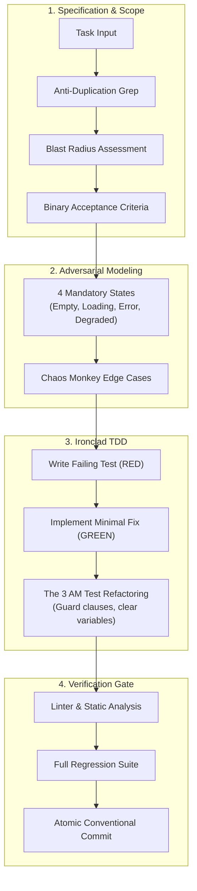

# Q.E.D.

**High-assurance engineering framework for AI-assisted software development.**

---

## Overview

AI coding assistants frequently generate code that appears plausible but degrades production repositories over time:

- **Unverified assertions**: Claiming bugs are fixed without executing a reproduction test.
- **Codebase erosion**: Introducing duplicate helpers and fragmented types instead of reusing existing utilities.
- **Happy-path bias**: Failing to implement empty states, loading boundaries, or error recovery.
- **Superficial workarounds**: Masking failures with empty catch blocks, arbitrary timeouts, or loose type casts.

**Q.E.D.** (*Quod Erat Demonstrandum — "which was to be demonstrated"*) is an engineering standard and configuration framework for autonomous coding agents. It enforces test-driven development, blast radius calculation, anti-duplication discipline, and deterministic verification gates across any AI development environment.

---

## Core Protocols

### 1. Blast Radius Analysis
Before modifying shared functions, database models, or API endpoints, the agent must inspect direct call sites and evaluate transitive impacts on schemas, serialization, and background workers. Changes are classified into Low, Medium, or Critical risk.

### 2. Anti-Duplication Radar
*"Search Before You Create."* The agent must search the repository for existing helpers, custom hooks, and shared models before introducing new abstractions. Duplicate utilities (`utils2.ts`, `formatDateCustom`) are forbidden.

### 3. The 4 Mandatory States
Code written only for successful responses is rejected. Every user-facing component and data route must explicitly handle:
- **Empty State**: Explicit UI and response when zero items exist.
- **Loading State**: Visual placeholder preventing layout shift during async operations.
- **Error State**: Actionable error message with a retry mechanism.
- **Degraded State**: Graceful fallback under timeouts or partial API failures.

### 4. The 3 AM Test
Code must remain instantly understandable to an engineer reviewing a production incident at 3:00 AM:
- Guard clauses and early returns to flatten execution flow.
- Explicitly named intermediate variables instead of multi-level chained functional one-liners.
- Explanatory doc comments with concrete input and output examples for non-obvious algorithms.

### 5. The Chaos Monkey Test
Automated tests must include adversarial edge cases: rapid duplicate clicks (500ms), oversized payloads (5MB+), complex Unicode (RTL text, composite emojis), and interrupted network connections.

---

## Workflow Lifecycle

Q.E.D. replaces guesswork with a deterministic state machine:



### Execution Example

```text
$ qed-agent "Implement idempotent wallet debit"

[1/4] ANTI-DUPLICATION & BLAST RADIUS
      Searching codebase for existing balance utilities...
      -> Found 'db.wallets.updateBalance()' in src/services/wallet.ts (reused).
      -> Direct callers: CheckoutController, SubscriptionCron (Risk: Medium).

[2/4] IRONCLAD TDD (RED STAGE)
      Writing reproduction test: test/wallet.test.ts:42
      $ npm test -- test/wallet.test.ts
      FAIL: Concurrent duplicate requests executed twice. Expected 1 charge.
      -> Failure verified.

[3/4] ROOT CAUSE FIX (GREEN STAGE)
      Adding unique idempotencyKey constraint & distributed lock...
      $ npm test -- test/wallet.test.ts
      PASS: 2 concurrent calls -> 1 debit, 1 cached response.

[4/4] VERIFICATION GATE & 3 AM AUDIT
      -> Flattened nested if/else into early guard clauses.
      -> Typecheck: OK (0 errors).
      -> Linter: OK (0 warnings).
      -> Full test suite: 64/64 passed (0 regressions).
      -> Created commit: feat(wallet): implement idempotent debit with lock
```

---

## Installation

### Windows (PowerShell)
```powershell
irm https://raw.githubusercontent.com/keelbismark/qed/main/install.ps1 | iex
```

### Linux / macOS (Bash)
```bash
curl -fsSL https://raw.githubusercontent.com/keelbismark/qed/main/install.sh | bash
```

### Targeted Installation
To configure Q.E.D. for a specific tool instead of all platforms:

```bash
# Example: configure Cursor rules only
./install.sh cursor

# Example: configure Claude Code rules only
./install.sh claude

# Example: install globally to user profile
./install.sh global all
```

Detailed installation flags and manual setups are documented in [docs/harnesses.md](docs/harnesses.md).

---

## Supported Harnesses

Q.E.D. includes native drop-in adapters and configuration files for 20 AI coding environments:

| Category | Environments |
| :--- | :--- |
| **IDEs and Editors** | Cursor AI, Windsurf Cascade, Roo Code, Cline, GitHub Copilot |
| **Terminal and CLI** | Claude Code, Aider, OpenCode, Gemini CLI, DeepSeek Harness (`dsh`), OpenAI Codex, xAI Grok, Qwen Code, Moonshot Kimi |
| **Autonomous Runtimes** | Google Antigravity, Cognition Devin, Factory Droid, Nous Hermes, Inflection Pi, Muse |

Full platform notes, manifest mappings, and custom slash command configurations are detailed in the [Harness Guide](docs/harnesses.md).

---

## Execution Modes

Q.E.D. supports two operating modes:

- **Mode A: Production (Default: Quality > Speed)**  
  Full engineering rigor. Requires red-green TDD cycles, blast radius calculation, adversarial testing, and verification before declaring work complete.
- **Mode B: Speed Mode (On-Demand: Speed > Quality)**  
  Activated only when the user explicitly requests speed (*"quick"*, *"prototype"*, *"draft"*, *"быстро"*). Delivers functional proof-of-concept code rapidly, accompanied by a report on shortcuts taken.

---

## Framework Comparison

| Capability | Q.E.D. | GitHub Spec-Kit | obra/superpowers | BMad Method | Default AI |
| :--- | :---: | :---: | :---: | :---: | :---: |
| **Evidence Before Assertions** | Enforced | Partial | Enforced | Partial | None |
| **Blast Radius Analysis** | Yes | No | No | No | No |
| **Anti-Duplication Radar** | Mandatory | No | No | No | No |
| **4 Mandatory States** | Enforced | Partial | No | Partial | None |
| **3 AM Readability Test** | Enforced | No | Partial | No | None |
| **Chaos Monkey Edge Cases** | Standard | No | Partial | No | None |
| **Supported Platforms** | 20 | 1 | 20 | 2 | None |
| **Context Overhead** | Minimal | Minimal | Minimal | Heavy | Uncontrolled |

---

## Documentation

- [Universal Constitution](core/CONSTITUTION.md) — The foundational engineering standard.
- [AI Directives (llms.txt)](llms.txt) — Token-dense entrypoint for LLM coding agents.
- [Core Protocols](docs/protocols.md) — Detailed technical guidelines and code examples.
- [Harness Guide](docs/harnesses.md) — Integration details for all 20 environments.
- [Templates](templates/) — Standard templates for Specifications, Architecture Decision Records (ADRs), and Technical Plans.
- [Walkthrough](examples/full-lifecycle-walkthrough.md) — End-to-end example implementing a feature under Q.E.D.

---

## License

MIT License. Copyright (c) 2026 KeelBismarck.
