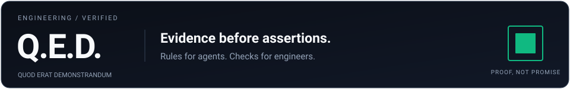
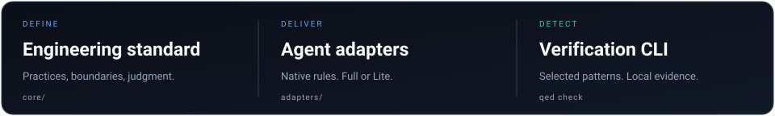
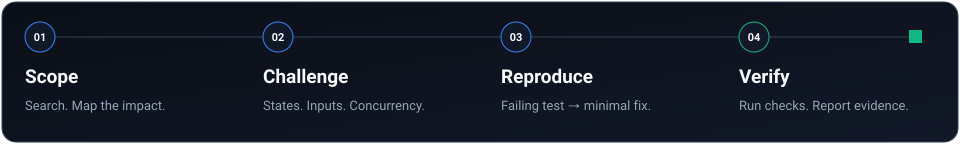

<p align="center">
  
</p>

<p align="center">
  <a href="LICENSE"></a>
  <a href="docs/harnesses.md"></a>
  <a href="core/CONSTITUTION.md"></a>
  <a href="core/CONSTITUTION.lite.md"></a>
  <a href="tests/verify-adapters.ps1"></a>
  <a href="llms.txt"></a>
</p>

<p align="center">
  <a href="#quickstart">Quickstart</a> •
  <a href="#the-problem-codebase-erosion">The Problem</a> •
  <a href="#framework-architecture">Architecture</a> •
  <a href="#the-12-pillars-of-qed">The 12 Pillars</a> •
  <a href="#how-it-works">Lifecycle</a> •
  <a href="#20-supported-platforms">20 Platforms</a> •
  <a href="llms.txt">llms.txt</a>
</p>

---

## The Problem: Codebase Erosion

AI pair-programming promised a 10x engineer. In practice, it frequently feels like reviewing PRs from an overcaffeinated junior developer:

> *"I've resolved the issue!"* — the agent announces.  
> You pull the branch. It never ran the tests. It broke three database queries. It hallucinated a deprecated library version. It created a second `formatDateHelper.ts` in another directory. And it silenced a fatal defect with `catch (e) {}`.

Code generated without physical boundaries is technical debt accumulating compound interest. We call it **codebase erosion**.

**Q.E.D.** (*Latin: "quod erat demonstrandum" — which was to be demonstrated*) is an open-source, high-assurance engineering standard and configuration layer for AI coding environments. It replaces vibes, guesses, and unverified assertions with deterministic engineering discipline.

---

## Framework Architecture

Q.E.D. organizes engineering discipline across three coordinated tiers: **Universal Invariants**, the **4-Phase Verification Engine**, and the **External Trust Contract**.

<p align="center">
  
</p>

---

## Before & After: Real-World Evidence

```typescript
// [WITHOUT Q.E.D.] Standard AI Generative Output
// Silent error swallowing, loose typing, happy-path assumption, zero tests executed
async function checkout(cart: any) {
  try {
    if (cart.items) {
      const total = cart.items.reduce((a: any, b: any) => a + b.price, 0);
      return await api.charge(total); // Floating point bug: 0.1 + 0.2 !== 0.3! No idempotency!
    }
  } catch (e) {
    console.log("error"); // Swallowed failure. UI hangs indefinitely.
  }
}
```

```typescript
// [WITH Q.E.D.] High-Assurance Output
// Guard clauses, integer minor units, 4 states handled, reproduction test verified RED first
async function checkout(cart: Cart): Promise<CheckoutResult> {
  if (!cart.items || cart.items.length === 0) {
    return { status: "empty", message: "Cart is empty" };
  }
  
  // Reused existing helper (Anti-Duplication) & Integer Minor Units (No floating-point currency)
  const totalMinorUnits = calculateCartTotalMinorUnits(cart.items);
  if (totalMinorUnits <= 0) {
    throw new InvalidOrderError("Total amount must be greater than zero");
  }

  // Idempotent charge with explicit timeout and retry boundary (Chaos Monkey verified)
  return await paymentGateway.chargeWithIdempotency({
    amountMinorUnits: totalMinorUnits,
    currency: cart.currency, // ISO 4217 Invariant
    idempotencyKey: cart.idempotencyKey,
  });
}
```

---

## How It Works: The 4-Phase Verification Loop

Every task executed under Q.E.D. traverses an ironclad, evidence-backed lifecycle:

<p align="center">
  
</p>

### Execution Trace Example

```text
$ qed "Add idempotent debit to wallet API"

[1/4] SPECIFICATION, ANTI-DUPLICATION & BLAST RADIUS
      -> Grepping codebase for existing wallet balance helpers...
      -> Found 'db.wallets.updateBalance()' in src/services/wallet.ts (reused).
      -> Callers: CheckoutController, SubscriptionCron (Blast Risk: Medium).

[2/4] ADVERSARIAL QA & 4 MANDATORY STATES
      -> Mapping edge cases: double-click in 50ms, expired JWT, zero balance, timeout.
      -> Implementing: Empty, Loading, Error (retryable), Degraded states.

[3/4] IRONCLAD TDD (REPRODUCTION FIRST)
      -> Authoring reproduction test: test/wallet.test.ts:42
      $ npm test -- test/wallet.test.ts
      FAIL: Concurrent duplicate debit executed twice. Expected 1 charge.
      -> Red state verified.
      -> Implementing minimal fix (row lock + unique idempotency constraint)...
      $ npm test -- test/wallet.test.ts
      PASS: 2 concurrent calls -> 1 debit, 1 cached response (Green verified).

[4/4] THE 3 AM AUDIT, SANITIZATION & VERIFICATION GATE
      -> Refactored nested if/else pyramids into early return guard clauses.
      -> Sanitization sweep: 0 console.log, 0 throwaway scripts, 0 dead imports.
      -> Static Typecheck: OK (0 errors).
      -> Linter: OK (0 warnings).
      -> Full Regression Suite: 64/64 passed (100% green).
      -> Commit: feat(wallet): implement idempotent debit with distributed lock
```

---

## The 12 Pillars of Q.E.D.

The standard is codified in 12 formal specification documents under [`core/`](core/):

| # | Pillar & Specification | Core Invariant | Risk Eliminated |
| :-: | :--- | :--- | :--- |
| **0** | **[Universal Constitution](core/CONSTITUTION.md)** | Quality > Speed by default; evidence before assertions; root cause only. | Speculative coding, cosmetic hacks, placebo fixes. |
| **1** | **[Testing Philosophy](core/testing-philosophy.md)** | Zero placebo mocks; mandatory boundary matrix; reproduction RED $\rightarrow$ GREEN. | Testing mocks instead of real software; flaky tests. |
| **2** | **[Adaptive Architecture](core/adaptive-architecture.md)** | Earned complexity; form follows data flow; pristine root; 10-second entrypoint. | Enterprise boilerplate on small tools; cluttered project roots. |
| **3** | **[Dependency Philosophy](core/dependency-philosophy.md)** | Build vs. Buy matrix; 4-pillar package health audit; The Wrapper Invariant. | Supply chain trojans, bloatware, unmaintained micro-packages. |
| **4** | **[Threat-Adaptive Security](core/security-philosophy.md)** | 4 Security Tiers; tenant-isolated IDOR checks; anti-security-theater UX (NIST 800). | IDOR leaks, mass assignment, user-hostile login barriers. |
| **5** | **[Earned Regionality & I18n](core/regionality-and-i18n.md)** | Level 0 baseline (UTF-8, UTC, integer money); native `Intl`; sovereign data residency. | Timezone shift bugs, float money bugs, GDPR fines. |
| **6** | **[Cache & Resource Hygiene](core/cache-memory-and-file-hygiene.md)** | Bounded LRU cache + TTL; tenant cache isolation; streams for >10MB; scoped temp cleanup. | Out-of-memory (OOM) crashes, 100% disk exhaustion, ghost data. |
| **7** | **[Data Fetching Philosophy](core/data-fetching-philosophy.md)** | Mandatory `AbortSignal` timeout; anti-`as` boundary parsing; Keyset pagination; Singleflight. | Hanging socket leaks, contract drift crashes, waterfall lag, IDOR. |
| **8** | **[Visual Anti-Slop Standard](core/visual-anti-slop-standard.md)** | The Archaeologist Invariant (preserve the Signature Spark); unboxed by default; anti-Bento; zero emojis. | Type 1 synthetic plastic carnival, Type 2 sterile hospital sheet brutalism. |
| **9** | **[Git & Pragmatic Versioning](core/git-and-versioning.md)** | Git change ledger $\neq$ Versioning trust contract; Bisect Invariant; changelog split. | Broken git bisect, unearned deprecation, leaked security flaws. |
| **10** | **[Naming & Semantics](core/naming-philosophy.md)** | Scope-proportional length; positive predicates; contract verbs (`get` vs `fetch`). | Ambiguous names (`data`, `temp`, `res`), misleading predicates. |
| **11** | **[Hygiene & Pre-Commit Sweep](core/hygiene-and-cleanup.md)** | Zero debug prints; throwaway script purge; clean git status before commit. | Production debug logs, leaked tokens, commit pollution. |

---

## Quickstart

Install Q.E.D. into your project in seconds:

### Windows (PowerShell)
```powershell
irm https://raw.githubusercontent.com/keelbismark/qed/main/install.ps1 | iex
```

### Linux / macOS (Bash)
```bash
curl -fsSL https://raw.githubusercontent.com/keelbismark/qed/main/install.sh | bash
```

### Targeted Platform Setup
Install configurations for a specific AI harness only:

```bash
./install.sh cursor      # Cursor AI (.cursorrules & modern .cursor/rules/*.mdc)
./install.sh claude      # Claude Code (CLAUDE.md, slash commands, skills)
./install.sh deepseek    # DeepSeek Harness (dsh) & Continue.dev
./install.sh roo         # Roo Code custom modes (Architect, TDD, Reviewer)
./install.sh global all  # Machine-wide installation across user profile
```

### Q.E.D. Lite (Token-Optimized Edition)
For fast or token-constrained models (**Claude 3.5 Haiku, Gemini Flash, GPT-4o-mini, local LLMs via Ollama/Llama 3/Qwen**), install the ultra-dense Lite edition (<500 tokens, ~80% token reduction) without sacrificing any core engineering invariants:

```bash
# Linux / macOS
./install.sh --lite             # Install Lite for all harnesses
./install.sh --lite claude      # Install Lite for Claude Code (CLAUDE.md)
./install.sh --lite cursor      # Install Lite for Cursor (.cursorrules)

# Windows (PowerShell)
.\install.ps1 -Lite             # Install Lite for all harnesses
.\install.ps1 -Lite -Harness claude
.\install.ps1 cursor -Lite
```

*Distinct Lite manifests are also directly available in the repository root and harness folders (`QED.lite.md`, `core/CONSTITUTION.lite.md`, `adapters/*/GEMINI.lite.md`, `CLAUDE.lite.md`, `.cursorrules.lite`).*

---

## 20 Supported Platforms

Q.E.D. provides native drop-in adapters and configuration manifests tailored to each tool's architecture:

| Environment | Primary Manifest | Key Capabilities |
| :--- | :--- | :--- |
| **Cursor AI** | `.cursorrules`, `.cursor/rules/*.mdc` | Modern MDC rules with YAML frontmatter for TDD and Blast Radius |
| **Claude Code** | `CLAUDE.md`, `.claude/commands/` | Slash commands (`/boost`, `/qed-verify`, `/qed-review`), skills |
| **Google Antigravity** | `GEMINI.md`, `.antigravity-plugin/` | Multi-agent orchestration, Evidence Before Assertions |
| **DeepSeek (dsh & Continue)**| `DEEPSEEK.md`, `.dsh/`, `.continue/` | R1 Chain-of-Thought directives, safety presets, slash commands |
| **Roo Code & Cline** | `.roomodes`, `.clinerules` | 3 custom roles: `Architect`, `TDD Engineer`, and `Reviewer` |
| **Windsurf Cascade** | `.windsurfrules`, workflows | Interactive workflows (`qed-boost`, `qed-tdd-cycle`) |
| **Aider** | `.aider.conventions.md` | Auto-test on commit (`auto-test: true`), Conventional Commits |
| **GitHub Copilot** | `copilot-instructions.md`, prompts | Instructions and prompt templates (`qed-boost`, `qed-spec`) |
| **OpenCode** | `opencode.json`, `plugins/qed.js` | In-process V1/V2 lifecycle plugin, sandbox constraints |
| **Codex, Grok, Kimi, Pi, Devin...** | Native manifests & configs | Full parity across 20 environments |

[View Full Harness Details & Manual Configurations →](docs/harnesses.md)

---

## Dual Execution Modes

Q.E.D. adapts to your velocity requirements:

* **Mode A (Production Mode — Default: `Quality > Speed`)**  
  Full engineering rigor. Red-Green-Refactor TDD cycles, blast radius calculation, adversarial testing, and verification gate before declaring work complete.
* **Mode B (Speed Mode — On-Demand: `Speed > Quality`)**  
  Triggered when you explicitly ask for speed (*"quick"*, *"prototype"*, *"draft"*, *"быстро"*, *"набросок"*). Delivers a working proof-of-concept immediately, accompanied by an explicit report detailing shortcuts taken and required hardening steps.

---

## Comparison Matrix

| Capability | Q.E.D. | GitHub Spec-Kit | obra/superpowers | BMad Method | Default AI |
| :--- | :---: | :---: | :---: | :---: | :---: |
| **Evidence Before Assertions** | **Enforced** | Partial | Enforced | Partial | None |
| **Blast Radius Analysis** | **Yes** | No | No | No | No |
| **Anti-Duplication Radar** | **Mandatory** | No | No | No | No |
| **Threat-Adaptive Security (4 Tiers)**| **Enforced** | No | No | No | None |
| **Earned Regionality & I18n** | **Enforced** | No | No | No | None |
| **Bounded Caches & Resource Hygiene**| **Enforced** | No | No | No | None |
| **4 Mandatory States** | **Enforced** | Partial | No | Partial | None |
| **3 AM Readability Test** | **Enforced** | No | Partial | No | None |
| **Chaos Monkey Edge Cases** | **Standard** | No | Partial | No | None |
| **Supported Platforms** | **20** | 1 | 20 | 2 | None |
| **Context Overhead** | **Minimal** | Minimal | Minimal | Heavy | Uncontrolled |

---

## Specification & Standards Library

* **[Universal Constitution](core/CONSTITUTION.md)** — Foundational articles governing agent behavior.
* **[Testing Philosophy](core/testing-philosophy.md)** — Zero placebo mocks, boundary matrix, mutation testing.
* **[Adaptive Architecture](core/adaptive-architecture.md)** — Anti-template dogmatism, earned complexity.
* **[Dependency Philosophy](core/dependency-philosophy.md)** — Build vs. Buy, 4-pillar audit, Wrapper Invariant.
* **[Threat-Adaptive Security](core/security-philosophy.md)** — 4 Security Tiers, NIST 800-63B, Tenant Isolation.
* **[Earned Regionality & I18n](core/regionality-and-i18n.md)** — Level 0-3 ladder, UTC wire, minor integer money.
* **[Cache, Memory & Resource Hygiene](core/cache-memory-and-file-hygiene.md)** — Bounded LRU, leak-free streams, temp cleanup.
* **[Data Fetching Philosophy](core/data-fetching-philosophy.md)** — Transport deadlines, boundary schema validation, Keyset pagination.
* **[Visual Anti-Slop & Human Interface](core/visual-anti-slop-standard.md)** — Unboxed by default, form follows data, zero UI emojis, anti-cyber slop.
* **[Git & Pragmatic Versioning](core/git-and-versioning.md)** — Change ledger vs. trust contract, Bisect Invariant.
* **[Naming & Semantics](core/naming-philosophy.md)** — Scope-proportional names, positive predicates, contract verbs.
* **[Hygiene & Pre-Commit Sweep](core/hygiene-and-cleanup.md)** — Zero-debug print invariant, dead code elimination.
* **[Comment Philosophy & Anti-Noise](core/comment-philosophy.md)** — Ban on syntax echo noise, Why-over-What rules.
* **[Documentation & Visual Standards](core/documentation-and-visuals.md)** — Human vs. AI separation, responsive SVG graphics.
* **[AI Agent Guide (llms.txt)](llms.txt)** — High-density machine entrypoint for LLMs.
* **[Harness Guide](docs/harnesses.md)** — Setup reference for all 20 platforms.
* **[Templates](templates/)** — Templates for Specs, Architecture Decision Records (ADRs), and Plans.
* **[End-to-End Walkthrough](examples/full-lifecycle-walkthrough.md)** — Real-world example building a feature under Q.E.D.

---

## License

MIT License. Copyright (c) 2026 KeelBismarck.
