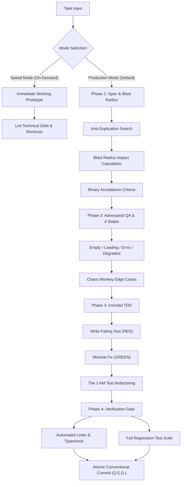

<div align="center">

# Q.E.D.
### *Quod Erat Demonstrandum*
**The High-Assurance Engineering Framework for Autonomous Coding Agents**

[](LICENSE)
[](core/CONSTITUTION.md)
[](adapters/)

*«Evidence Before Assertions» — Turning AI pair-programmers into disciplined Staff Engineers.*

[English](README.md) • [Конституция (RU/EN)](core/CONSTITUTION.md) • [Quickstart](#-quickstart) • [Supported Harnesses](#-supported-harnesses) • [Core Superpowers](#-the-5-unique-superpowers)

</div>

---

## 🎯 What is Q.E.D.?

**Q.E.D.** (*Latin: Quod Erat Demonstrandum — "Which was to be demonstrated"*) is an open-source engineering standard and operational protocol for AI-assisted software development.

Most AI coding assistants suffer from **"vibe coding"**: they generate code that compiles and looks superficially correct, but silently rots the codebase with duplicate utilities, untested edge cases, breaking contract changes, and zero automated verification.

Q.E.D. synthesizes the best ideas from **GitHub Spec-Kit**, **obra/superpowers**, and **BMad Method** into a unified, battle-tested standard that forces AI agents to adhere to rigorous software engineering discipline:

1. **No Code Without Verification**: Never claim a task is complete without running real tests and showing execution evidence.
2. **Root Cause Only**: Complete ban on hacky `setTimeout`, empty `catch` blocks, or loose `any` type casts.
3. **Dual Execution Modes**: Production mode (`Quality > Speed`) by default; instant prototype mode (`Speed > Quality`) on-demand.

---

## ⚡ The 5 Unique Superpowers of Q.E.D.

Unlike generic prompt collections, Q.E.D. introduces 5 distinct engineering mechanisms designed to protect real-world production codebases:

```
┌─────────────────────────────────────────────────────────────────────────────┐
│                       THE 5 PILLARS OF Q.E.D.                               │
├──────────────────────────┬──────────────────────────────────────────────────┤
│ 1. Blast Radius Analysis │ Calculates direct callers & indirect API/DB risk │
│                          │ before modifying existing shared code.           │
├──────────────────────────┼──────────────────────────────────────────────────┤
│ 2. Anti-Duplication      │ "Search Before You Create": greps codebase to    │
│    Radar                 │ prevent duplicate helpers, types, and hooks.     │
├──────────────────────────┼──────────────────────────────────────────────────┤
│ 3. The 4 Mandatory       │ Ban on Happy-Path-only code. Every flow must     │
│    States                │ handle Empty, Loading, Error, and Degraded.      │
├──────────────────────────┼──────────────────────────────────────────────────┤
│ 4. The "3 AM Test"       │ Cognitive ergonomics: flat guard clauses, early  │
│                          │ returns, descriptive names, zero opaque one-line │
│                          │ functional acrobatics.                           │
├──────────────────────────┼──────────────────────────────────────────────────┤
│ 5. The Chaos Monkey      │ Adversarial testing: rapid double-clicks (500ms),│
│    Test                  │ 5MB payloads, hostile RTL/Unicode, abort states. │
└──────────────────────────┴──────────────────────────────────────────────────┘
```

---

## 📊 Comparison Matrix

| Capability | Q.E.D. | GitHub Spec-Kit | obra/superpowers | BMad Method | Vanilla AI |
| :--- | :---: | :---: | :---: | :---: | :---: |
| **Evidence Before Assertions** | ✅ **Strict** | ⚠️ Partial | ✅ **Strict** | ⚠️ Partial | ❌ None |
| **Blast Radius Analysis** | ✅ **Built-in** | ❌ None | ❌ None | ❌ None | ❌ None |
| **Anti-Duplication Radar** | ✅ **Mandatory** | ❌ None | ❌ None | ❌ None | ❌ None |
| **4 States (Empty/Load/Err/Degraded)**| ✅ **Mandatory** | ⚠️ Partial | ❌ None | ⚠️ Partial | ❌ None |
| **The "3 AM Test" (Anti-Slop)** | ✅ **Enforced** | ❌ None | ⚠️ Partial | ❌ None | ❌ None |
| **The Chaos Monkey Test** | ✅ **Standard** | ❌ None | ⚠️ Partial | ❌ None | ❌ None |
| **Ironclad TDD (Red-Green-Refactor)** | ✅ **Strict** | ❌ None | ✅ **Strict** | ⚠️ Optional | ❌ None |
| **Token & Overhead Efficiency** | 🚀 **Lean** | 🚀 **Lean** | 🚀 **Lean** | 🐢 Verbose | ⚡ Uncontrolled |
| **Cross-Agent Drop-in Support** | ✅ **Universal (9 Harnesses)**| ⚠️ CLI-only | ⚠️ Harness | ⚠️ Cursor/Claude | ❌ None |

---

## 🔄 The Q.E.D. Lifecycle



---

## 🛠️ Supported Harnesses & Architecture

Q.E.D. provides first-class, native configurations and adapters tailored specifically to the execution models of all major AI coding harnesses:

| Harness | Configuration Files | Special Features |
| :--- | :--- | :--- |
| **Cursor** | `.cursorrules` + `.cursor/rules/*.mdc` | Legacy fallback + modern MDC rules with frontmatter (`globs`, `alwaysApply`) for TDD, Blast Radius, Anti-Duplication, and 3 AM readability. |
| **Claude Code** | `CLAUDE.md` + `.claude/skills/` + `.claude/commands/` | High-fidelity bash execution guidelines, permission scoping, custom skills, and slash commands (`/qed-verify`, `/qed-review`, `/qed-blast-radius`). |
| **Cline** | `.clinerules` | Autonomous agent rules enforcing pre-flight searches, verification gates, and zero secret leaks. |
| **Roo Code** | `.roomodes` + `.clinerules` | Custom role modes: `Q.E.D. Architect` (specs & blast radius), `Q.E.D. TDD Engineer` (red-green-refactor), and `Q.E.D. QA Reviewer`. |
| **Windsurf** | `.windsurfrules` + `.windsurf/workflows/*.md` | Cascade rules + interactive workflows (`qed-spec-and-blast-radius`, `qed-tdd-cycle`, `qed-verification-gate`). |
| **Aider** | `.aider.conf.yml` + `.aider.conventions.md` | Auto-testing (`auto-test: true`), Conventional Commits automation, and strict linter integration. |
| **GitHub Copilot** | `.github/copilot-instructions.md` + `.github/prompts/*.prompt.md` | Workspace instructions + reusable prompt files (`qed-spec.prompt.md`, `qed-verify.prompt.md`, `qed-tdd.prompt.md`). |
| **Google Antigravity** | `GEMINI.md` | Autonomous multi-agent directives enforcing Evidence Before Assertions and dual modes. |
| **OpenCode** | `opencode.json` + `.opencoderules` + `OPENCODE.md` | Machine-readable schema configuration, sandbox constraints, and verification hooks. |

---

## 🚀 Quickstart

### 1. One-Click Installation (PowerShell / Windows)

Install for your specific harness or all harnesses at once:

```powershell
# Install all harnesses locally in current repository
.\install.ps1 -Harness all

# Install for a specific harness
.\install.ps1 -Harness cursor
.\install.ps1 -Harness claude
.\install.ps1 -Harness cline
.\install.ps1 -Harness roo
.\install.ps1 -Harness windsurf
.\install.ps1 -Harness aider
.\install.ps1 -Harness copilot
.\install.ps1 -Harness opencode
.\install.ps1 -Harness antigravity

# Or install globally to user profile
.\install.ps1 -Target global -Harness all
```

### 2. One-Click Installation (Linux / macOS / Bash)

```bash
# Install all harnesses locally in current repository
./install.sh local all

# Install for a specific harness
./install.sh --harness cursor
./install.sh --harness claude
./install.sh --harness cline
./install.sh --harness roo
./install.sh --harness windsurf
./install.sh --harness aider
./install.sh --harness copilot
./install.sh --harness opencode
./install.sh --harness antigravity

# Or install globally
./install.sh global all
```

### 3. Remote One-Liner Quick-Install

**Linux / macOS (Bash):**
```bash
# Install Cursor rules locally
curl -fsSL https://raw.githubusercontent.com/keelbismark/qed/main/install.sh | bash -s -- --harness cursor

# Install Claude Code rules locally
curl -fsSL https://raw.githubusercontent.com/keelbismark/qed/main/install.sh | bash -s -- --harness claude

# Install all adapters
curl -fsSL https://raw.githubusercontent.com/keelbismark/qed/main/install.sh | bash -s -- --harness all
```

**Windows (PowerShell):**
```powershell
# Install Cursor rules locally
iex "& { $(irm https://raw.githubusercontent.com/keelbismark/qed/main/install.ps1) } -Harness cursor"

# Install Claude Code rules locally
iex "& { $(irm https://raw.githubusercontent.com/keelbismark/qed/main/install.ps1) } -Harness claude"

# Install all adapters
iex "& { $(irm https://raw.githubusercontent.com/keelbismark/qed/main/install.ps1) } -Harness all"
```

---

## 📂 Repository Structure

```text
qed/
├── README.md               # Framework documentation and manifesto
├── LICENSE                 # MIT License
├── install.ps1             # PowerShell 1-click multi-harness installer
├── install.sh              # Bash 1-click multi-harness installer
├── core/                   # The Core Q.E.D. Specifications
│   ├── CONSTITUTION.md     # Universal Engineering Constitution
│   ├── blast-radius.md     # Blast Radius Analysis Protocol
│   ├── anti-duplication.md # Anti-Duplication Radar
│   ├── chaos-monkey.md     # The Chaos Monkey Test Protocol
│   └── three-am-test.md    # The 3 AM Readability Test
├── adapters/               # Native Harness Configurations
│   ├── antigravity/        # Google Antigravity (GEMINI.md)
│   ├── cursor/             # Cursor AI (.cursorrules & .cursor/rules/*.mdc)
│   ├── claude-code/        # Claude Code (CLAUDE.md, .claude/skills/*, .claude/commands/*)
│   ├── cline/              # Cline (.clinerules)
│   ├── roo-code/           # Roo Code (.roomodes & .clinerules)
│   ├── windsurf/           # Windsurf Cascade (.windsurfrules & workflows/*)
│   ├── aider/              # Aider (.aider.conf.yml & .aider.conventions.md)
│   ├── copilot/            # GitHub Copilot (.github/copilot-instructions.md & prompts/*)
│   └── opencode/           # OpenCode (opencode.json, .opencoderules, OPENCODE.md)
├── templates/              # Standard Artifact Templates
│   ├── SPEC_TEMPLATE.md    # Specification Template (What & Why)
│   ├── ADR_TEMPLATE.md     # Architecture Decision Record
│   └── PLAN_TEMPLATE.md    # Technical Blueprint & Task Breakdown
└── examples/
    └── full-lifecycle-walkthrough.md
```

---

## 📜 The Core Directive

> **Evidence Before Assertions.**
> A task is not done when the code is written. A task is done when the test has run, the output has been verified, the edge cases have been assaulted, and the commit is clean.

---

## 👤 Author & License

Created by **[KeelBismarck](https://github.com/keelbismark)**.  
Released under the [MIT License](LICENSE).
