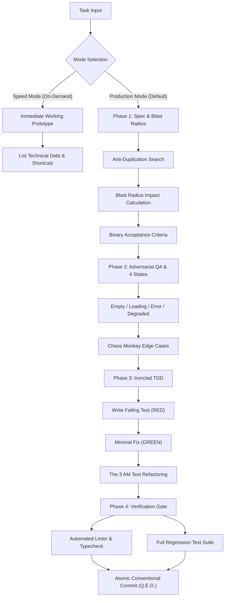

<div align="center">

# Q.E.D.
### *Quod Erat Demonstrandum*
**The High-Assurance Engineering Framework for Autonomous Coding Agents**

[](LICENSE)
[](core/CONSTITUTION.md)
[](adapters/)

*«Evidence Before Assertions» — Turning AI pair-programmers into disciplined Staff Engineers.*

[English](README.md) • [Конституция (RU/EN)](core/CONSTITUTION.md) • [Quickstart](#-quickstart) • [Supported Harnesses](#-supported-harnesses--architecture) • [Core Superpowers](#-the-5-unique-superpowers-of-qed)

</div>

---

## 🎯 What is Q.E.D.?

**Q.E.D.** (*Latin: Quod Erat Demonstrandum — "Which was to be demonstrated"*) is an open-source engineering standard and operational protocol for AI-assisted software development.

Most AI coding assistants suffer from **"vibe coding"**: they generate code that compiles and looks superficially correct, but silently rots the codebase with duplicate utilities, untested edge cases, breaking contract changes, and zero automated verification.

Q.E.D. synthesizes the best ideas from **GitHub Spec-Kit**, **obra/superpowers**, and **BMad Method** into a unified, battle-tested standard that forces AI agents to adhere to rigorous software engineering discipline:

1. **No Code Without Verification**: Never claim a task is complete without running real tests and showing execution evidence.
2. **Root Cause Only**: Complete ban on hacky `setTimeout`, empty `catch` blocks, or loose `any` type casts.
3. **Dual Execution Modes**: Production mode (`Quality > Speed`) by default; instant prototype mode (`Speed > Quality`) on-demand.

---

## ⚡ The 5 Unique Superpowers of Q.E.D.

Unlike generic prompt collections, Q.E.D. introduces 5 distinct engineering mechanisms designed to protect real-world production codebases:

```
┌─────────────────────────────────────────────────────────────────────────────┐
│                       THE 5 PILLARS OF Q.E.D.                               │
├──────────────────────────┬──────────────────────────────────────────────────┤
│ 1. Blast Radius Analysis │ Calculates direct callers & indirect API/DB risk │
│                          │ before modifying existing shared code.           │
├──────────────────────────┼──────────────────────────────────────────────────┤
│ 2. Anti-Duplication      │ "Search Before You Create": greps codebase to    │
│    Radar                 │ prevent duplicate helpers, types, and hooks.     │
├──────────────────────────┼──────────────────────────────────────────────────┤
│ 3. The 4 Mandatory       │ Ban on Happy-Path-only code. Every flow must     │
│    States                │ handle Empty, Loading, Error, and Degraded.      │
├──────────────────────────┼──────────────────────────────────────────────────┤
│ 4. The "3 AM Test"       │ Cognitive ergonomics: flat guard clauses, early  │
│                          │ returns, descriptive names, zero opaque one-line │
│                          │ functional acrobatics.                           │
├──────────────────────────┼──────────────────────────────────────────────────┤
│ 5. The Chaos Monkey      │ Adversarial testing: rapid double-clicks (500ms),│
│    Test                  │ 5MB payloads, hostile RTL/Unicode, abort states. │
└──────────────────────────┴──────────────────────────────────────────────────┘
```

---

## 📊 Comparison Matrix

| Capability | Q.E.D. | GitHub Spec-Kit | obra/superpowers | BMad Method | Vanilla AI |
| :--- | :---: | :---: | :---: | :---: | :---: |
| **Evidence Before Assertions** | ✅ **Strict** | ⚠️ Partial | ✅ **Strict** | ⚠️ Partial | ❌ None |
| **Blast Radius Analysis** | ✅ **Built-in** | ❌ None | ❌ None | ❌ None | ❌ None |
| **Anti-Duplication Radar** | ✅ **Mandatory** | ❌ None | ❌ None | ❌ None | ❌ None |
| **4 States (Empty/Load/Err/Degraded)**| ✅ **Mandatory** | ⚠️ Partial | ❌ None | ⚠️ Partial | ❌ None |
| **The "3 AM Test" (Anti-Slop)** | ✅ **Enforced** | ❌ None | ⚠️ Partial | ❌ None | ❌ None |
| **The Chaos Monkey Test** | ✅ **Standard** | ❌ None | ⚠️ Partial | ❌ None | ❌ None |
| **Ironclad TDD (Red-Green-Refactor)** | ✅ **Strict** | ❌ None | ✅ **Strict** | ⚠️ Optional | ❌ None |
| **Token & Overhead Efficiency** | 🚀 **Lean** | 🚀 **Lean** | 🚀 **Lean** | 🐢 Verbose | ⚡ Uncontrolled |
| **Cross-Agent Drop-in Support** | ✅ **Universal (20 Harnesses)**| ⚠️ CLI-only | ⚠️ Partial | ⚠️ Cursor/Claude | ❌ None |

---

## 🔄 The Q.E.D. Lifecycle



---

## 🛠️ Supported Harnesses & Architecture

Q.E.D. provides first-class, native configurations and adapters tailored specifically to the execution models of **all 20 major AI coding harnesses**:

| Harness | Configuration Files | Special Features |
| :--- | :--- | :--- |
| **Google Antigravity** | `GEMINI.md` + `.antigravity-plugin/plugin.json` | Multi-agent directives, marketplace plugin support, and Evidence Before Assertions. |
| **Gemini CLI** | `GEMINI.md` + `gemini-extension.json` | Native extension manifest with `@generalist` subagent mappings and `write_todos` tracking. |
| **Cursor** | `.cursorrules` + `.cursor-plugin/` + `.cursor/rules/*.mdc` | Legacy fallback + modern MDC rules with frontmatter (`globs`, `alwaysApply`) for TDD and Blast Radius. |
| **Claude Code** | `CLAUDE.md` + `.claude/skills/` + `skills/` + `.claude/commands/` + `.claude-plugin/` | High-fidelity bash execution rules, custom skills, and slash commands (`/boost`, `/qed-boost`, `/qed-verify`, `/qed-review`, `/qed-blast-radius`). |
| **OpenAI Codex** | `CODEX.md` + `AGENTS.md` + `.codex-plugin/plugin.json` | Native Codex App & CLI manifest, AGENTS.md instruction convention, and strict terminal TDD. |
| **Kimi Code** | `KIMI.md` + `.kimi-plugin/plugin.json` | Moonshot AI Kimi manifest with auto `sessionStart.skill`, `AskUserQuestion` clarification tool, and `TodoList` integration. |
| **Pi Coding Agent** | `PI.md` + `package.json` + `.pi/extensions/qed.ts` | In-process extension injecting Q.E.D. constitution on session start, compaction (ordered after summaries), and context. |
| **Hermes Agent** | `HERMES.md` + `.hermes-plugin/plugin.yaml` + `__init__.py` | Native Python plugin providing kwargs-tolerant `pre_llm_call` hook injection and tool mappings. |
| **Muse** | `MUSE.md` + `.muse-plugin/plugin.json` + `marketplace.json` | Native Muse plugin manifest with `SessionStart` hooks and marketplace registration. |
| **Devin CLI** | `DEVIN.md` + `.devin-plugin/plugin.json` + `.devin/config.json` | Cognition Devin playbook and configuration enforcing Evidence Before Assertions. |
| **Factory Droid** | `DROID.md` + `.agents/plugins/marketplace.json` + `.droid/config.json` | Factory Droid plugin marketplace integration and workspace rules. |
| **Grok Build CLI** | `GROK.md` + `.grok-plugin/plugin.json` + `.grok/config.json` | xAI Grok Build CLI plugin ecosystem configuration and anti-duplication radar. |
| **Qwen Code** | `QWEN.md` + `.qwenrules` + `.qwen/config.json` | Alibaba Qwen Code CLI and extension configuration with 4-state discipline. |
| **OpenCode** | `opencode.json` + `.opencoderules` + `OPENCODE.md` + `.opencode/plugins/qed.js` + `index.js` | Machine-readable schema configuration, sandbox constraints, and in-process V1/V2 lifecycle plugins. |
| **DeepSeek (dsh & Continue)** | `DEEPSEEK.md` + `.deepseekrules` + `.dsh/` + `.continue/` | DeepSeek-R1 Chain-of-Thought reasoning directives and Continue.dev custom commands (`/qed-boost`). |
| **Cline** | `.clinerules` | Autonomous agent rules enforcing pre-flight searches, verification gates, and zero secret leaks. |
| **Roo Code** | `.roomodes` + `.clinerules` | Custom role modes: `Q.E.D. Architect`, `Q.E.D. TDD Engineer`, and `Q.E.D. QA Reviewer`. |
| **Windsurf** | `.windsurfrules` + `.windsurf/workflows/*.md` | Cascade rules + interactive workflows (`qed-boost`, `qed-spec-and-blast-radius`, `qed-tdd-cycle`, `qed-verification-gate`). |
| **Aider** | `.aider.conf.yml` + `.aider.conventions.md` | Auto-testing (`auto-test: true`), Conventional Commits automation, and strict linter integration. |
| **GitHub Copilot** | `.github/copilot-instructions.md` + `.github/prompts/*.prompt.md` | Workspace instructions + reusable prompt files (`qed-boost`, `qed-spec`, `qed-verify`, `qed-tdd`). |

---

## 🚀 Quickstart

### 1. One-Click Installation (PowerShell / Windows)

Install for your specific harness or all harnesses at once:

```powershell
# Install all 20 harnesses locally in current repository
.\install.ps1 -Harness all

# Install for a specific harness
.\install.ps1 cursor
.\install.ps1 claude
.\install.ps1 codex
.\install.ps1 gemini
.\install.ps1 antigravity
.\install.ps1 kimi
.\install.ps1 pi
.\install.ps1 hermes
.\install.ps1 muse
.\install.ps1 devin
.\install.ps1 droid
.\install.ps1 grok
.\install.ps1 qwen
.\install.ps1 opencode
.\install.ps1 deepseek
.\install.ps1 windsurf
.\install.ps1 cline
.\install.ps1 roo
.\install.ps1 aider
.\install.ps1 copilot

# Or install globally to user profile
.\install.ps1 -Target global -Harness all
```

### 2. One-Click Installation (Linux / macOS / Bash)

```bash
# Install all 20 harnesses locally in current repository
./install.sh local all

# Install for a specific harness
./install.sh cursor
./install.sh claude
./install.sh codex
./install.sh gemini
./install.sh kimi
./install.sh pi
./install.sh hermes
./install.sh muse
./install.sh devin
./install.sh droid
./install.sh grok
./install.sh qwen
./install.sh opencode
./install.sh deepseek
./install.sh windsurf
./install.sh cline
./install.sh roo
./install.sh aider
./install.sh copilot

# Or install globally to user profile
./install.sh global all
```

### 3. Remote One-Liner Quick-Install

**Linux / macOS (Bash):**
```bash
# Install Cursor rules locally
curl -fsSL https://raw.githubusercontent.com/keelbismark/qed/main/install.sh | bash -s -- --harness cursor

# Install Claude Code rules locally
curl -fsSL https://raw.githubusercontent.com/keelbismark/qed/main/install.sh | bash -s -- --harness claude

# Install all adapters
curl -fsSL https://raw.githubusercontent.com/keelbismark/qed/main/install.sh | bash -s -- --harness all
```

**Windows (PowerShell):**
```powershell
# Install Cursor rules locally
iex "& { $(irm https://raw.githubusercontent.com/keelbismark/qed/main/install.ps1) } -Harness cursor"

# Install Claude Code rules locally
iex "& { $(irm https://raw.githubusercontent.com/keelbismark/qed/main/install.ps1) } -Harness claude"

# Install all adapters
iex "& { $(irm https://raw.githubusercontent.com/keelbismark/qed/main/install.ps1) } -Harness all"
```

---

## 📂 Repository Structure

```text
qed/
├── README.md               # Framework documentation and manifesto
├── LICENSE                 # MIT License
├── install.ps1             # PowerShell 1-click multi-harness installer (20 harnesses)
├── install.sh              # Bash 1-click multi-harness installer (20 harnesses)
├── core/                   # The Core Q.E.D. Specifications
│   ├── CONSTITUTION.md     # Universal Engineering Constitution
│   ├── blast-radius.md     # Blast Radius Analysis Protocol
│   ├── anti-duplication.md # Anti-Duplication Radar
│   ├── chaos-monkey.md     # The Chaos Monkey Test Protocol
│   └── three-am-test.md    # The 3 AM Readability Test
├── adapters/               # Native Configurations for 20 Harnesses
│   ├── antigravity/        # Google Antigravity (GEMINI.md, .antigravity-plugin/*)
│   ├── gemini/             # Gemini CLI (GEMINI.md, gemini-extension.json)
│   ├── cursor/             # Cursor AI (.cursorrules, .cursor-plugin/*, .cursor/rules/*.mdc)
│   ├── claude-code/        # Claude Code (CLAUDE.md, .claude-plugin/*, skills/*, commands/*)
│   ├── codex/              # OpenAI Codex (CODEX.md, AGENTS.md, .codex-plugin/*)
│   ├── kimi/               # Kimi Code (KIMI.md, .kimi-plugin/*)
│   ├── pi/                 # Pi Coding Agent (PI.md, package.json, .pi/extensions/*)
│   ├── hermes/             # Hermes Agent (HERMES.md, .hermes-plugin/*)
│   ├── muse/               # Muse Agent (MUSE.md, .muse-plugin/*)
│   ├── devin/              # Devin CLI (DEVIN.md, .devin-plugin/*, .devin/*)
│   ├── droid/              # Factory Droid (DROID.md, .agents/plugins/*, .droid/*)
│   ├── grok/               # Grok Build CLI (GROK.md, .grok-plugin/*, .grok/*)
│   ├── qwen/               # Qwen Code (QWEN.md, .qwenrules, .qwen/*)
│   ├── opencode/           # OpenCode (opencode.json, .opencoderules, OPENCODE.md)
│   ├── deepseek/           # DeepSeek (DEEPSEEK.md, .deepseekrules, .dsh/*, .continue/*)
│   ├── cline/              # Cline (.clinerules)
│   ├── roo-code/           # Roo Code (.roomodes & .clinerules)
│   ├── windsurf/           # Windsurf Cascade (.windsurfrules & workflows/*)
│   ├── aider/              # Aider (.aider.conf.yml & .aider.conventions.md)
│   └── copilot/            # GitHub Copilot (.github/copilot-instructions.md & prompts/*)
├── templates/              # Standard Artifact Templates
│   ├── SPEC_TEMPLATE.md    # Specification Template (What & Why)
│   ├── ADR_TEMPLATE.md     # Architecture Decision Record
│   └── PLAN_TEMPLATE.md    # Technical Blueprint & Task Breakdown
├── tests/                  # Cross-Platform Comprehensive Test Suites
│   ├── verify-adapters.ps1 # PowerShell Verification Suite (25 test suites)
│   └── verify-adapters.sh  # Bash Verification Suite (26 test suites)
└── examples/
    └── full-lifecycle-walkthrough.md
```

---

## 📜 The Core Directive

> **Evidence Before Assertions.**
> A task is not done when the code is written. A task is done when the test has run, the output has been verified, the edge cases have been assaulted, and the commit is clean.

---

## 👤 Author & License

Created by **[KeelBismarck](https://github.com/keelbismark)**.  
Released under the [MIT License](LICENSE).
