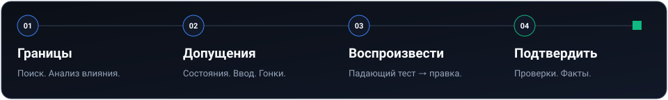
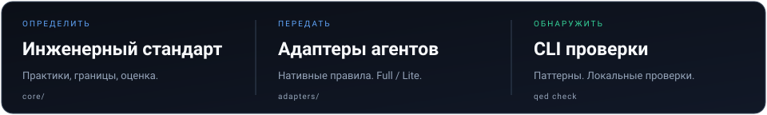

[English](README.md) · [Русский](README.ru.md) · [简体中文](README.zh-CN.md)

# Качественному коду нужны доказательства, а не уверенный тон.

**Q.E.D. — инженерный стандарт и CLI без runtime-зависимостей для разработки с ИИ.** Дайте агенту явные правила, а затем проверяйте часть этих правил механически.

[Статус CI](https://github.com/keelbismark/qed/actions/workflows/ci.yml) · [Пакет npm](https://www.npmjs.com/package/qed-standard) · [Лицензия MIT](LICENSE)

[Быстрый старт](#быстрый-старт) · [Как это работает](#как-это-работает) · [Команды CLI](#команды-cli) · [Документация](#документация)

---

## «Исправлено» не означает «проверено».

Агент может убедительно описать решение, но оставить зависающий запрос, проглоченное исключение или дубликат функции. Q.E.D. задаёт конкретные ожидания: искать перед созданием, воспроизводить перед исправлением и запускать проверки перед заявлением об успехе.

**До — запрос без ограничения времени**

```js
const response = await fetch(url);
```

**После — явный таймаут**

```js
const response = await fetch(url, {
  signal: AbortSignal.timeout(5000),
});
```

CLI обнаруживает отсутствие timeout/signal. Это **не доказывает**, что endpoint безопасен или ответ корректен: проверка статуса, валидация схемы и поведенческие тесты остаются задачами приложения.

| Уровень | Что даёт |
| :--- | :--- |
| **Стандарт** | Инженерные практики для тестирования, безопасности, данных, архитектуры и UX. |
| **Адаптеры агентов** | Нативные инструкции и конфигурации для 20 сред разработки с ИИ. |
| **CLI проверки** | Поиск отдельных антипаттернов, запуск тестов и установка Git-хуков. |

## Быстрый старт

### 1. Проверьте свой проект

Нужен **Node.js 18+**. Выполните в репозитории, который хотите проверить:

```bash
npx qed-standard check
```

Глобальная установка не нужна. У CLI нет runtime-зависимостей; при первом запуске `npx` скачает пакет.

Если нужна постоянная команда:

```bash
npm install -g qed-standard
qed check
```

Автоматизация в **GitHub Actions**:

```yaml
- name: Q.E.D. Verification Gate
  uses: keelbismark/qed@main
  with:
    strict: true
```

### 2. Передайте агенту правила

Клонируйте этот репозиторий и запустите его установщик **из каталога своего проекта**. Пример для Cursor:

```bash
git clone https://github.com/keelbismark/qed.git /path/to/qed
cd /path/to/your-project
bash /path/to/qed/install.sh cursor
```

На Windows используйте PowerShell:

```powershell
git clone https://github.com/keelbismark/qed.git C:\tools\qed
cd C:\path\to\your-project
& C:\tools\qed\install.ps1 -Harness cursor
```

Вместо `cursor` можно указать `claude`, `codex`, `copilot`, `roo` или другую [поддерживаемую среду](docs/harnesses.md). Сначала проверьте текущие конфигурации: установщик может перезаписать совпадающие файлы. Локальная установка действует на текущий проект, а `global` — на профиль пользователя.

### 3. Сделайте проверку привычкой

```bash
qed check          # Проверить текущий проект
qed hook           # Установить проверки pre-commit и pre-push
qed doctor         # Проверить репозиторий, хуки, среды выполнения и доступность CI
```

Перед установкой изучите существующие хуки. Q.E.D. дополняет проверку типов, тесты приложения, аудит безопасности и CI, но не заменяет их.

**Мало места в контексте?** Используйте Lite:

```bash
bash /path/to/qed/install.sh --lite cursor
```

Или передайте агенту компактный [промпт Q.E.D. Lite](QED.lite.md) без запуска установщика.

## Как это работает



1. **Границы.** Найдите готовые реализации и определите затронутые вызовы.
2. **Проверка допущений.** Учтите пустое состояние, загрузку, ошибку и деградацию; проверьте опасные входные данные и конкурентные операции.
3. **Воспроизведение.** Запустите падающий тест, внесите минимальное исправление и убедитесь, что тест проходит.
4. **Подтверждение.** Запустите нужные проверки типов, линтер и регрессионные тесты. Укажите, что реально запускалось, а что осталось непроверенным.

Это процесс, которому стандарт предлагает следовать агенту, **а не автоматический конвейер команды `qed check`**. Полный пример — в [разборе жизненного цикла задачи](examples/full-lifecycle-walkthrough.md).

### Два режима с явными компромиссами

По умолчанию **качество важнее скорости**: анализ влияния, воспроизводящие тесты и проверка изменений. **Режим прототипа** включается по запросу: минимальный объём, явный список упрощений и технического долга. Неподтверждённые заявления недопустимы в обоих режимах.

## Что проверяет CLI

Проверка ищет определённые паттерны в поддерживаемых исходных файлах. Часть правил использует лексический анализ или AST; это не полный семантический анализ и не аудит безопасности.

| Область | Примеры |
| :--- | :--- |
| Гигиена репозитория | Временные файлы в корне, отладочные инструкции |
| Ошибки и типы | Пустые `catch`, приведения `as any` |
| Ограничение ресурсов | Запросы без timeout/signal, экспортируемые неограниченные Map |
| Секреты и конфигурация | Паттерны встроенных учётных данных, недокументированные переменные окружения |
| Семантика интерфейса | Кликабельные div, блокировка вставки, перегруженные эмодзи элементы UI |
| Изменения БД | Паттерны `CREATE INDEX` без `CONCURRENTLY` |

Это **12 правил, QED001–QED012**. Более широкий стандарт содержит практики, для которых нужны тесты и инженерная оценка. Чистый результат говорит о выполненных проверках, а не о безошибочности приложения.

## Команды CLI

После глобальной установки используйте `qed`; в клоне этого репозитория — `node bin/qed-engine.js`.

| Команда | Назначение |
| :--- | :--- |
| `qed check [path]` | Проверить текущий каталог или указанный проект |
| `qed check --strict` | Считать предупреждения ошибками проверки |
| `qed check --json` | Получить машиночитаемый результат |
| `qed check --compact` | Получить краткий вывод для агента |
| `qed test` | Запустить доступные наборы `tests/verify-*.sh` и `tests/verify-*.ps1` |
| `qed doctor` | Проверить репозиторий, хуки, интерпретаторы, механизм анализа и удалённый CI |
| `qed hook` | Установить механические проверки в Git-хуки |
| `qed tokens` | Оценить объём инструкций в токенах |

Для `check` код завершения `0` означает отсутствие ошибок, а в строгом режиме — и предупреждений. При провале код ненулевой. Для PowerShell-тестов нужен PowerShell, для POSIX-тестов — Bash. У `doctor` и проверки CI есть дополнительные требования к локальным инструментам.

Настройка правил проекта описана в [руководстве по протоколам](docs/protocols.md) и [схеме конфигурации](schema/qedrc.schema.json).

## Один стандарт, разные среды



Cursor · Claude Code · Antigravity · Gemini CLI · Codex · Kimi Code · Pi · Hermes · Muse · Devin · Factory Droid · Grok · Qwen Code · OpenCode · DeepSeek / Continue · Cline · Roo Code · Windsurf · Aider · GitHub Copilot

Форматы и нативные функции адаптеров различаются. Точные файлы, параметры установки и Lite-варианты приведены в [каталоге сред](docs/harnesses.md).

## Документация

Основные руководства ниже пока доступны на английском.

| Задача | С чего начать |
| :--- | :--- |
| Понять базовые правила | [Конституция](core/CONSTITUTION.md) |
| Настроить редактор или агента | [Интеграция сред](docs/harnesses.md) |
| Разобрать задачу от начала до конца | [Жизненный цикл](examples/full-lifecycle-walkthrough.md) |
| Улучшить тестирование | [Философия тестов](core/testing-philosophy.md) |
| Безопасно работать с API | [Получение данных](core/data-fetching-philosophy.md) |
| Улучшить безопасность и миграции | [Безопасность](core/security-philosophy.md) · [Эволюция БД](core/database-evolution-and-migrations.md) |
| Проектировать полезный интерфейс | [Визуальный стандарт](core/visual-anti-slop-standard.md) · [Эргономика](core/workflow-ergonomics-and-affordances.md) |
| Реверс-инжиниринг контрактов | [Реверс-инжиниринг и граундинг (REA)](core/reverse-engineering-and-grounding.md) |
| Визуальная верификация интерфейсов | [Computer-Use и визуальный гейт (CUA)](core/computer-use-and-visual-verification.md) |
| Понять результаты оценки | [Методология](docs/evals.md) · [Тестовые примеры](evals/scenarios.json) |
| Передать контекст ИИ | [AI_README.md](AI_README.md) · [llms.txt](llms.txt) |

### Как читать результаты оценки

Встроенная оценка запускает заранее подготовленные варианты кода «vanilla» и «Q.E.D.» через линтер в шести сценариях. Это демонстрация обнаружения паттернов на конкретных примерах, **не** сравнение моделей в реальном времени и не общая гарантия снижения числа дефектов. Перед интерпретацией изучите [код запуска](evals/run-benchmark.js) и [методологию](docs/evals.md).

## Участие в проекте

Для POSIX-проверок достаточно Node.js 18+ и Bash; для локального запуска Windows-наборов также нужен PowerShell. В клоне репозитория:

```bash
node bin/qed-engine.js check
node bin/qed-engine.js test
```

Компиляция приложения не требуется. Делайте изменения узкими по смыслу, добавляйте воспроизведение поведенческих ошибок и указывайте выполненные проверки. Об ошибках и предложениях сообщайте в [issues](https://github.com/keelbismark/qed/issues), изменения отправляйте через [pull requests](https://github.com/keelbismark/qed/pulls).

---

**Q.E.D.** — *Quod erat demonstrandum*, «что и требовалось доказать».  
[MIT](LICENSE) · Автор проекта — [KeelBismarck](https://github.com/keelbismark)
