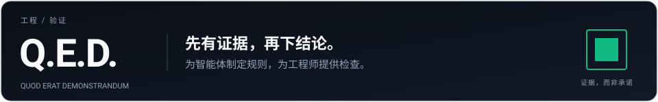
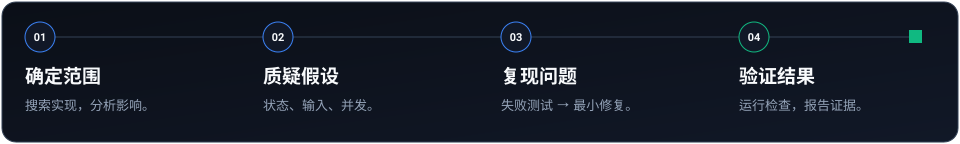
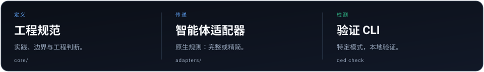

[English](README.md) · [Русский](README.ru.md) · [简体中文](README.zh-CN.md)

# 好代码需要证据，而不只是自信的解释。

**Q.E.D. 是面向 AI 辅助开发的工程规范，以及一个没有运行时依赖的 CLI。** 为编程智能体提供明确的规则，再用自动化检查验证其中可以机械检测的部分。

[CI 状态](https://github.com/keelbismark/qed/actions/workflows/ci.yml) · [npm 软件包](https://www.npmjs.com/package/qed-standard) · [MIT 许可证](LICENSE)

[快速开始](#快速开始) · [新手指南](docs/GETTING_STARTED.zh-CN.md) · [工作流程](#工作流程) · [CLI 命令](#cli-命令) · [文档导航](#文档导航)

---

## “已修复”不等于“已验证”。

智能体可能给出令人信服的解释，却留下永不结束的请求、被吞掉的异常或重复的工具函数。Q.E.D. 把要求具体化：创建前先搜索，修复前先复现，宣告成功前先运行检查。

**之前：没有时间限制的网络请求**

```js
const response = await fetch(url);
```

**之后：明确设置超时**

```js
const response = await fetch(url, {
  signal: AbortSignal.timeout(5000),
});
```

CLI 检测缺少 timeout/signal 的模式，但这**不能证明**接口安全或响应有效。状态码处理、数据结构校验和行为测试仍然需要由应用实现。

| 层次 | 提供什么 |
| :--- | :--- |
| **工程规范** | 测试、安全、数据、架构和用户体验方面的书面实践。 |
| **智能体适配器** | 面向 20 种 AI 编程环境的原生指令与配置。 |
| **验证 CLI** | 检测特定反模式，并提供测试运行和 Git 钩子命令。 |

## 快速开始

> 需要从零开始、涵盖安装到 Mode A 严格结对编程的完整分步指南？阅读 **[快速上手指南](docs/GETTING_STARTED.zh-CN.md)**。

### 1. 检查你的项目

需要 **Node.js 18+**。在要检查的仓库目录中运行：

```bash
npx qed-standard check
```

无需全局安装。CLI 没有运行时包依赖；首次使用时，`npx` 会下载该软件包。

如果希望长期使用本地命令：

```bash
npm install -g qed-standard
qed check
```

在 **GitHub Actions** 中自动运行：

```yaml
- name: Q.E.D. Verification Gate
  uses: keelbismark/qed@main
  with:
    strict: true
```

### 2. 把规则交给智能体

克隆本仓库，然后**在目标项目目录中**运行安装脚本。以下示例安装 Cursor 规则：

```bash
git clone https://github.com/keelbismark/qed.git /path/to/qed
cd /path/to/your-project
bash /path/to/qed/install.sh cursor
```

Windows 用户可使用 PowerShell：

```powershell
git clone https://github.com/keelbismark/qed.git C:\tools\qed
cd C:\path\to\your-project
& C:\tools\qed\install.ps1 -Harness cursor
```

将 `cursor` 替换为 `claude`、`codex`、`copilot`、`roo` 或其他[受支持的环境](docs/harnesses.md)。请先检查已有配置：安装脚本可能覆盖同名文件。本地安装作用于当前项目，`global` 则作用于用户目录。

### 3. 把验证纳入日常流程

```bash
qed check          # 检查当前项目
qed hook           # 安装 pre-commit 和 pre-push 验证钩子
qed doctor         # 检查仓库、钩子、适配器漂移及 CI 可用性
qed update         # 将已安装的适配器与钩子同步至最新规范
```

安装前请检查已有钩子。Q.E.D. 是类型检查、应用测试、安全审查和 CI 的补充，而不是替代品。

**上下文预算有限？** 可以使用 Lite 版：

```bash
bash /path/to/qed/install.sh --lite cursor
```

也可以直接使用精简的 [Q.E.D. Lite 提示词](QED.lite.md)，无需运行安装脚本。

## 工作流程



1. **确定范围。** 查找已有实现，梳理受影响的调用方。
2. **质疑假设。** 覆盖空状态、加载、错误和降级行为，并考虑恶意输入及并发操作。
3. **复现问题。** 先运行失败的测试，再实施最小修复，确认测试通过。
4. **验证结果。** 运行相关类型检查、代码检查和回归测试，说明实际执行了什么，以及哪些内容尚未验证。

这是规范要求智能体遵循的工作方式，**不是 `qed check` 自动执行的流水线**。完整示例见[任务全生命周期演练](examples/full-lifecycle-walkthrough.md)。

### 两种模式，明确说明取舍

默认采用**质量优先**：分析影响、编写复现测试并验证变更。需要快速试验时，可明确启用**原型模式**：缩小范围，并列出简化措施和技术债务。无论哪种模式，都不能把未经验证的结论当作事实。

## CLI 检查什么

检查器在受支持的源文件中检测特定模式。部分规则使用词法分析或 AST 分析，但这并不是完整的语义分析或安全审计。

| 领域 | 示例 |
| :--- | :--- |
| 仓库整洁性 | 根目录临时文件、遗留调试语句 |
| 错误与类型约束 | 空 `catch`、宽泛的 `as any` 类型断言 |
| 资源边界 | 缺少 timeout/signal 的请求、导出的无界 Map |
| 密钥与配置 | 硬编码凭证模式、未记录的环境变量读取 |
| 界面语义 | 可点击 div、禁止粘贴、过度使用表情符号的界面元素 |
| 数据库演进 | 不包含 `CONCURRENTLY` 的 `CREATE INDEX` 模式 |

对应 **12 个规则编号：QED001–QED012**。更广泛的工程规范仍需要测试和人工判断。检查通过只说明这些检查没有发现问题，不代表整个应用完全正确。

## CLI 命令

全局安装后使用 `qed`；在本仓库的克隆目录中使用 `node bin/qed-engine.js`。

| 命令 | 用途 |
| :--- | :--- |
| `qed check [path]` | 扫描当前目录或指定项目 |
| `qed check --strict` | 同时将警告视为检查失败 |
| `qed check --json` | 输出机器可读结果 |
| `qed check --compact` | 输出适合智能体阅读的简洁结果 |
| `qed test` | 运行可用的 `tests/verify-*.sh` 和 `tests/verify-*.ps1` 测试集 |
| `qed doctor` | 审查仓库、钩子、适配器漂移、分析引擎和远程 CI |
| `qed hook` | 安装自动化 Git 验证钩子 |
| `qed update [path]` | 同步已安装的 AI 智能体适配器与 Git 钩子 |
| `qed update --global` | 同步全局用户适配器（`~/.gemini/`、`~/.claude/` 等） |
| `qed tokens` | 查看指令的 token 用量 |

对 `check` 而言，退出码 `0` 表示没有错误；严格模式下还要求没有警告。检查失败时返回非零退出码。PowerShell 测试需要 PowerShell，POSIX 测试需要 Bash。`doctor` 和 CI 检查还依赖额外的本地工具。

项目策略与配置请参阅[协议指南](docs/protocols.md)和[配置结构定义](schema/qedrc.schema.json)。

## 同一套规范，多种开发环境



Cursor · Claude Code · Antigravity · Gemini CLI · Codex · Kimi Code · Pi · Hermes · Muse · Devin · Factory Droid · Grok · Qwen Code · OpenCode · DeepSeek / Continue · Cline · Roo Code · Windsurf · Aider · GitHub Copilot

各适配器的格式和原生功能并不相同。具体文件、安装参数与 Lite 版本见[环境目录](docs/harnesses.md)。

## 文档导航

| 你想要…… | 从这里开始 |
| :--- | :--- |
| 从零开始 (新手分步演练) | [快速上手指南](docs/GETTING_STARTED.zh-CN.md) |
| 理解基础规则 | [工程宪章](core/CONSTITUTION.md) |
| 配置编辑器或智能体 | [环境集成指南](docs/harnesses.md) |
| 了解完整任务流程 | [生命周期演练](examples/full-lifecycle-walkthrough.md) |
| 改善测试实践 | [测试理念](core/testing-philosophy.md) |
| 安全处理 API 数据 | [数据获取规范](core/data-fetching-philosophy.md) |
| 改善安全与数据库迁移 | [安全规范](core/security-philosophy.md) · [数据库演进](core/database-evolution-and-migrations.md) |
| 构建实用界面 | [视觉规范](core/visual-anti-slop-standard.md) · [工作流体验](core/workflow-ergonomics-and-affordances.md) |
| 逆向工程与契约提取 | [逆向工程与契约落地 (REA)](core/reverse-engineering-and-grounding.md) |
| 真实浏览器界面视觉校验 | [Computer-Use 与视觉验证门禁 (CUA)](core/computer-use-and-visual-verification.md) |
| 约束子智能体并防止代码膨胀 | [子智能体治理与约束原则 (The Leash Invariant)](core/subagent-governance-and-delegation.md) |
| 理解评估结果 | [评估方法](docs/evals.md) · [测试样例](evals/scenarios.json) |
| 为 AI 提供上下文 | [AI_README.md](AI_README.md) · [llms.txt](llms.txt) |

### 如何解读评估结果

内置评估在六个场景中，将预先编写的“vanilla”和“Q.E.D.”代码样例交给检查器。它展示的是规则对这些样例的检测能力，**并非**实时模型对比，也不能保证普遍降低缺陷率。解读结果前，请阅读[运行脚本](evals/run-benchmark.js)和[评估方法](docs/evals.md)。

## 参与贡献

POSIX 检查需要 Node.js 18+ 和 Bash；如需在本地运行 Windows 测试集，还需要安装 PowerShell。在克隆目录中运行：

```bash
node bin/qed-engine.js check
node bin/qed-engine.js test
```

无需编译应用。请让变更聚焦于单一目标，为行为修复提供复现，并说明实际运行的检查。问题和提案请提交到 [issues](https://github.com/keelbismark/qed/issues)，代码修改请通过 [pull requests](https://github.com/keelbismark/qed/pulls) 提交。

## 致谢

Q.E.D. 借鉴并基于开源社区的成果与理念构建：
- [Awesome-REA](https://github.com/reacher-z/Awesome-REA) 与 [`rea-agents`](https://www.npmjs.com/package/rea-agents) — 提供逆向工程全景图与契约提取工具链。
- [Awesome-CUA](https://github.com/reacher-z/Awesome-CUA) — 提供计算机使用智能体 (Computer-Use Agents) 基准与界面落地验证参考。

---

**Q.E.D.** — *Quod erat demonstrandum*，即“证毕”。  
[MIT](LICENSE) · 项目维护者：[KeelBismarck](https://github.com/keelbismark)
