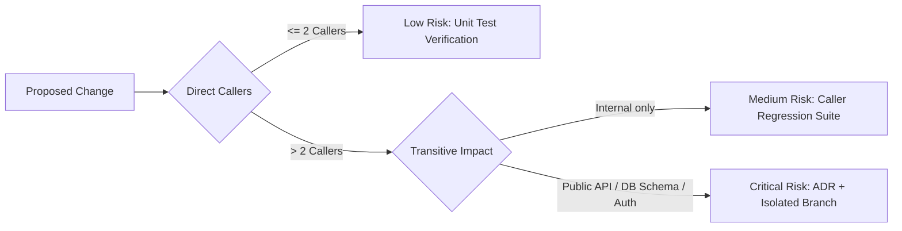
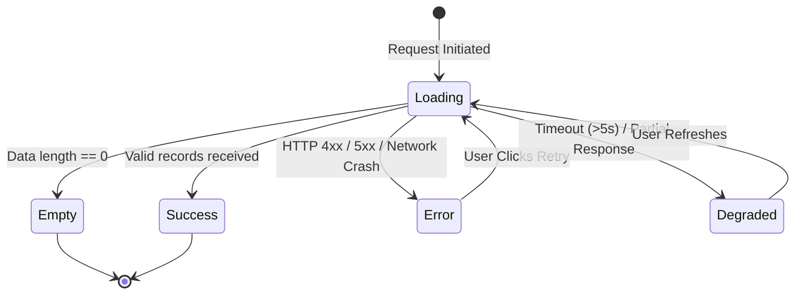

# The 5 Core Engineering Protocols of Q.E.D.

This document details the operational mechanics, anti-patterns, and code examples for each of Q.E.D.'s five core protocols.

---

## 1. Blast Radius Analysis
*Prevents the "butterfly effect" where changing one function silently breaks distant features.*

### The Protocol:
Before modifying any shared function, database schema, or API interface:
1. Identify all direct call sites using grep or AST search.
2. Check transitive dependencies (APIs, caches, background jobs, database serialization).
3. Classify risk:
   - **Low**: $\le 2$ callers, internal private utility.
   - **Medium**: Shared utility or model with existing unit tests.
   - **Critical**: Database schemas, auth logic, or public API endpoints.

---

## 2. Anti-Duplication Radar ("Search Before You Create")
*Stops codebases from decaying into dozens of duplicate helper functions.*

### The Problem:
AI agents working on a project frequently invent redundant utilities (`formatDate()`, `formatDateCustom()`, `dateUtils.ts`) because searching the codebase takes more tokens than generating a new function.

### The Protocol:
Before creating any new function, hook, or type:
1. Search semantic stems (`format`, `date`, `token`, `fetch`, `validate`) across the repository.
2. If an equivalent exists: **reuse or extend it** with backward compatibility.
3. Completely forbidden: `utils2.ts`, `helpers_new.ts`, duplicate regex validators.

---

## 3. The 4 Mandatory States of Any UI & Data Flow
*Eliminates the "Happy Path Only" syndrome.*

Every user-facing component or backend route must handle 4 states:
1. **Empty State**: What the user sees when 0 items exist (informative message + clear call-to-action).
2. **Loading State**: Visual skeleton or indicator that prevents Cumulative Layout Shift (CLS).
3. **Error State**: Actionable, human-friendly error message with a retry button (no infinite spinners or blank screens).
4. **Degraded / Offline State**: Graceful fallback under network timeouts or partial API failures.

---

## 4. The "3 AM Test" (Cognitive Ergonomics)
*Code must be instantly understandable by an exhausted engineer at 3:00 AM.*

### Key Rules:
- **Guard Clauses & Early Returns**: Flatten execution flow instead of nesting `if/else` ladders 4 levels deep.
- **Descriptive Intermediate Variables**: Replace long, opaque functional chains (`.map().filter().reduce().flat()`) with clearly named intermediate variables.
- **Concrete Examples in Comments**: For non-trivial regex, bitwise logic, or complex algorithms, provide concrete input $\rightarrow$ output examples in comments.

---

## 5. The Chaos Monkey Test
*Adversarial testing against erratic, hostile, or chaotic real-world inputs.*

Include test cases for:
- **10 rapid duplicate clicks** on mutations within 500ms (idempotency & debouncing).
- **Oversized payloads** (5MB–10MB string paste).
- **Hostile strings**: Composite emojis (`👨‍👩‍👧‍👦`), RTL Arabic/Hebrew text, SQL/HTML injection vectors.
- **Aborted requests**: Network cancellation or socket death mid-flight.
